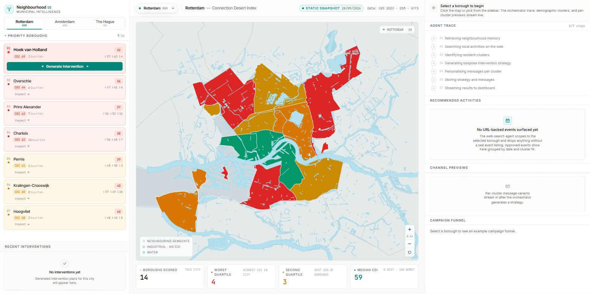
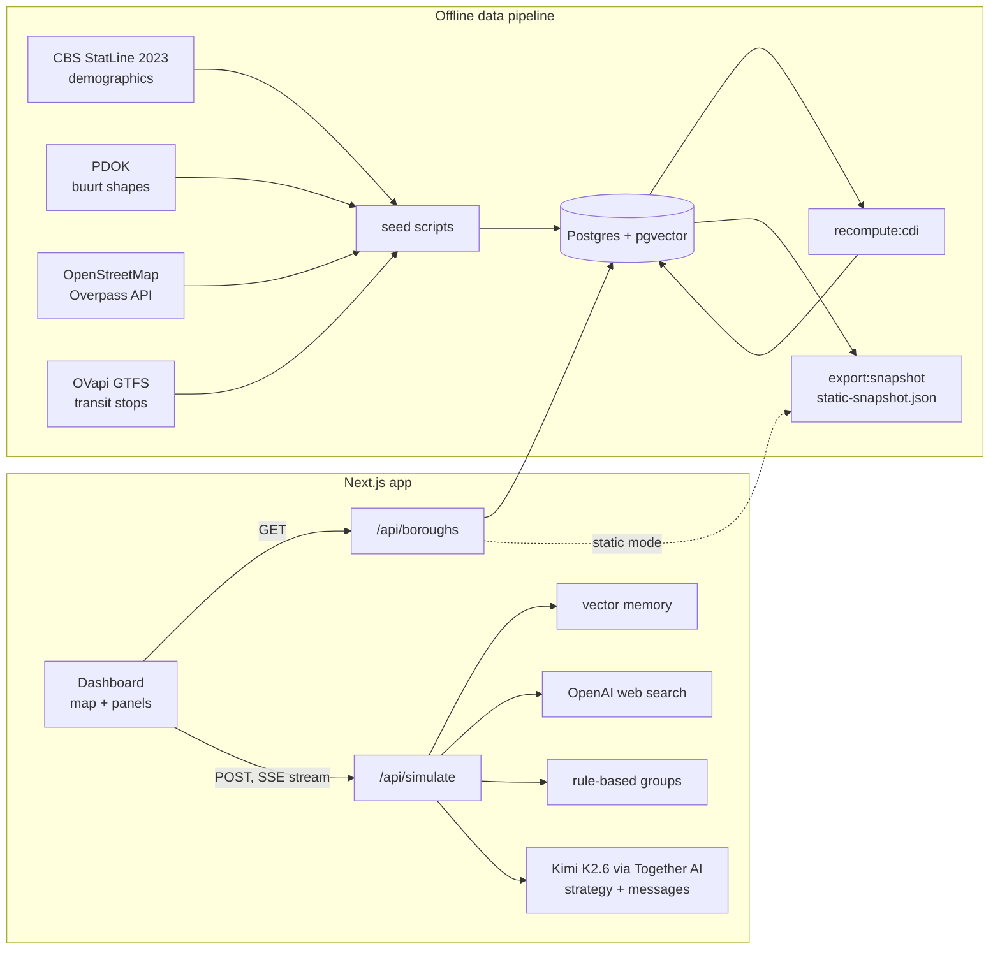

# Neighbourhood OS

A prototype dashboard that ranks neighbourhoods in Rotterdam, Amsterdam and The Hague by a
**Connection Desert Index**. The index combines CBS demographics, OpenStreetMap amenities and
public-transport access. For a chosen area, an LLM pipeline drafts a local outreach plan:
real upcoming events, matched to resident groups, with one invitation per channel.

I built it solo in 36 hours at EurHackNL 2026 for BCG's "The Lonely City" challenge. The
brief asked how Dutch municipalities could reach isolated residents who never show up to
existing community programmes, without labelling or tracking individuals. The prototype only
uses aggregate, neighbourhood-level data.

> **Status:** hackathon prototype. The index is not validated against measured loneliness,
> and the campaign numbers in the UI are illustrative. See [Limitations](#limitations).



## What it does

1. **Scores every buurt (CBS neighbourhood) in the three cities.** Offline scripts pull
   public data and compute the Connection Desert Index (CDI, 0–100, higher = fewer conditions
   for social connection).
2. **Shows it on a map at borough level.** Boroughs are coloured by within-city quartile, and
   a detail view breaks the score into its components and lists the worst buurten.
3. **Drafts an intervention for a borough.** Clicking _Generate_ runs an agent pipeline on the
   borough's worst-scoring buurt and streams each step to the browser:
   - retrieves notes about the area from a small vector memory (Postgres + pgvector);
   - searches the web for real upcoming local events (only results with an event URL are kept);
   - picks up to three resident groups with simple rules (for example, 65+ share ≥ 22% →
     "elderly, low digital literacy, reach by leaflet");
   - asks an LLM to match events to groups and write a short rationale;
   - writes one invitation per group in parallel (SMS, WhatsApp, Instagram, TikTok or a
     printable PDF leaflet).
4. **Approval step.** Approving an activity generates ad images (Ideogram) and a QR code, and
   can create _paused_ Meta/TikTok campaigns through the Pipeboard MCP server. Nothing is ever
   sent to residents.

## How it works



### The Connection Desert Index

All inputs are min-max normalised **within each city**: the lowest buurt gets 0, the highest 100. The weights are my own choices, not fitted to outcome data.

| Component                    | Inputs (weight inside the component)                                                                                                       | Weight in CDI      |
| ---------------------------- | ------------------------------------------------------------------------------------------------------------------------------------------ | ------------------ |
| **V**: vulnerability         | share aged 65+ (0.55), share of one-person households (0.45)                                                                               | 0.40               |
| **A**: access barriers       | few transit stops within 500 m (0.30), few pedestrian crossings within 500 m (0.25), distance to nearest GP (0.30), weather penalty (0.15) | 0.35               |
| **S**: social infrastructure | points for libraries and community centres (3), parks and sports centres (2), cafés and benches (1) within 500 m                           | 0.25, as (100 − S) |

`CDI = 0.40·V + 0.35·A + 0.25·(100 − S)`, in [`src/lib/score.ts`](src/lib/score.ts).
Buurten with fewer than 50 residents or 25 households are set to 50 (neutral). A borough's CDI
is the plain average of its buurten.

### Static snapshot mode

Without a database the app still runs. The read APIs serve
[`src/lib/data/static-snapshot.json`](src/lib/data/static-snapshot.json), which is exported
from a real pipeline run with the same query code. _Generate_ replays a hand-written sample
run for Amsterdam-Noord, clearly labelled as such, and approval is disabled. Set
`DATABASE_URL` and the API keys to use the live pipeline.

## Tech stack

- **App:** Next.js 16 (App Router), React 19, TypeScript, Tailwind CSS 4, shadcn/ui,
  react-simple-maps + d3-geo, Recharts
- **Data:** Postgres 16 with pgvector and pg_trgm, Drizzle ORM, postgres.js
- **AI:** Kimi K2.6 on Together AI (OpenAI-compatible API, JSON mode) for strategy and
  messages; OpenAI `gpt-4o-mini` web search for events; OpenAI `text-embedding-3-large`
  (1536 dims) for memory; Ideogram 3.0 via Together for ad images
- **Other:** Server-Sent Events for streaming, `@react-pdf/renderer` for leaflets,
  Model Context Protocol client for Pipeboard, `node:test` + tsx for tests

## Getting started

Requires Node 22+ and pnpm 10+.

### Static mode (no keys, no database)

```bash
pnpm install
pnpm dev
```

Open http://localhost:3000. The map, borough details and the Amsterdam-Noord sample run work;
live generation and approval are disabled.

### Full mode

Requires Docker, plus Together AI and OpenAI keys for the agent pipeline.

```bash
cp .env.example .env        # set DATABASE_URL, TOGETHER_AI_API_KEY, OPENAI_API_KEY
docker compose up -d        # Postgres 16 + pgvector on localhost:5433
pnpm pipeline               # migrations, public-data pipeline, CDI, snapshot export
pnpm seed:memory            # optional: memory notes for the agent (see Limitations)
pnpm dev
```

`pnpm pipeline` runs the steps below in order. Each one can also be run on its own.

| Step                                   | Source                                             |
| -------------------------------------- | -------------------------------------------------- |
| `db:migrate`                           | applies `drizzle/*.sql`                            |
| `seed`                                 | CBS table 85618NED, Open-Meteo                     |
| `populate:centroids`, `populate:names` | PDOK wijken en buurten 2023                        |
| `refresh:demographics`                 | CBS (flags buurten with too few residents)         |
| `populate:osm`                         | Overpass API, 21 bulk requests                     |
| `populate:transit`                     | OVapi GTFS feed (cached in `.cache/`)              |
| `recompute:cdi`                        | computes the index and assigns buurten to boroughs |
| `export:snapshot`                      | writes the static snapshot                         |

### Checks

```bash
pnpm test      # node:test suite (CDI maths, grouping rules, borough shaping, static-mode API)
pnpm lint
pnpm build
```

## Results

There is no outcome evaluation: no intervention was run, and the index has not been compared
with measured loneliness. What can be reported is what the pipeline produced and what the index
ends up tracking. The numbers below come from a full pipeline run on 28 September 2026 (the data
in the committed snapshot).

**Coverage**

| City      | Buurten scored | Too few residents (set to 50) | Not matched to a borough | Buurt CDI min / median / max |
| --------- | -------------- | ----------------------------- | ------------------------ | ---------------------------- |
| Amsterdam | 517            | 70                            | 6                        | 30.2 / 50.0 / 73.2           |
| Rotterdam | 91             | 9                             | 3                        | 30.8 / 55.6 / 79.6           |
| The Hague | 114            | 4                             | 1                        | 23.9 / 48.1 / 82.9           |

That gives 722 buurten in 31 residential boroughs (Rotterdam's port area is excluded).

**Highest-scoring boroughs** (average buurt CDI)

- Amsterdam: Noord 56.2, Weesp 56.1, Zuidoost 54.6
- Rotterdam: Hoek van Holland 68.8 (2 buurten), Overschie 63.7, Prins Alexander 62.9
- The Hague: Loosduinen 58.7, Scheveningen 52.9, Escamp 51.2

**What the index tracks.** Across the 639 buurten with enough residents, the CDI correlates
with the share of residents aged 65+ (r = 0.46) and inversely with transit stops within 500 m
(r = −0.54). It barely moves with the share of one-person households (r = −0.07) or the
low-income indicator (r = −0.11), even though the one-person-household share carries 45% of
the vulnerability component's weight. Dense inner-city buurten have many single households but
also many amenities and stops, so they score low. In practice the index ranks outer, older and less
connected areas highest. Whether that is where loneliness actually concentrates is the open
question a validation step would have to answer.

**Tests.** `pnpm test` runs 21 unit and integration tests. They check that the formula behaves
as specified, not that it is right.

## Limitations

- **The index is not validated.** The weights are hand-set, and nothing checks the CDI
  against measured loneliness. A natural next step is to correlate it with the RIVM/GGD
  _Gezondheidsmonitor_ small-area estimates of loneliness per wijk.
- **Two CBS inputs are missing.** CBS no longer publishes single-parent share or population
  turnover at buurt level, so both are stored as 0 (the detail view shows "n/a"). The two
  resident-group rules that use them never fire.
- **Resident groups are rules, not clustering.** Group sizes assume about 7,000 residents
  per buurt.
- **Impact numbers are illustrative.** The strategy's "estimated gain" and "cost per
  connection" are LLM outputs constrained to ranges in the prompt (with fixed fallbacks when
  the LLM fails). The campaign funnel panel shows fixed example values.
- **The memory holds synthetic history.** `pnpm seed:memory` stores a templated profile per
  buurt plus two invented past outcomes, which the agent may cite.
- **Nothing reaches residents.** There is no SMS or WhatsApp sending, and ad campaigns are
  created paused. The Pipeboard integration guesses the MCP tool name and argument shape, so
  treat it as experimental.
- **Weather is a snapshot.** It is one forecast value per city at pipeline run time, so it
  never changes the ranking within a city.
- **The agent trace is paced.** Two near-instant steps are padded to about 1.5 s so the trace
  is readable.

## Licence

MIT, see [LICENSE](LICENSE).
